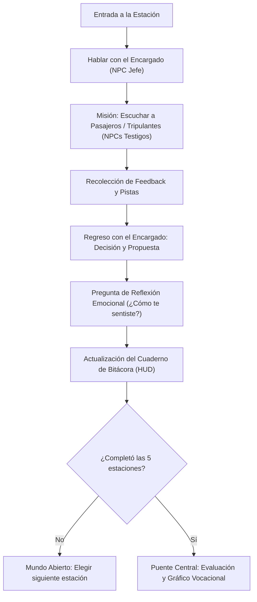

# Software Design Document (SDD)
## Proyecto: Odisea Vocacional Estelar (Tech Career Space Odyssey)
**Versión:** 1.0.0  
**Enfoque:** Spec-Driven Development (SDD)  
**Motor:** Phaser 4 (HTML5 Canvas / WebGL)  
**Público Objetivo:** Estudiantes ingresantes o preuniversitarios (sin formación técnica previa)

---

## 1. Visión General del Producto

### 1.1 Objetivo
Crear una experiencia inmersiva tipo RPG top-down 2D ambientada en una nave espacial de exploración. El jugador asume el rol de un tripulante novato que asiste a los jefes de departamento (NPCs principales) resolviendo situaciones del día a día mediante la interacción con pasajeros y tripulantes, recolección de feedback, toma de decisiones intuitivas y reflexión personal.

### 1.2 Salida Vocacional
Al completar las 5 áreas de la nave, el sistema entrega un perfil vocacional porcentual basado en un modelo multicriterio que evalúa afinidad hacia 5 grandes ramas de Tecnologías de la Información (TI):
1. **Desarrollo de Software** (*Construir, programar y crear herramientas*)
2. **Redes e Infraestructura** (*Conectar, mantener caminos y asegurar que todo fluya*)
3. **Seguridad Informática** (*Proteger, prevenir trampas y resguardar la privacidad*)
4. **Ciencia de Datos e Inteligencia Artificial** (*Encontrar patrones, predecir tendencias y aprender de la información*)
5. **Gestión y Análisis de Negocios** (*Organizar prioridades, entender necesidades de las personas y liderar soluciones*)

---

## 2. Principios de Diseño Narrativo y Lenguaje

### 2.1 Enfoque Coloquial y Accesible (Zero-Jargon)
* **Prohibido el uso de términos técnicos excluyentes**: No hablar de "APIs", "TCP/IP", "Machine Learning", "Firewalls", "Scrum" o "Bases de datos SQL".
* **Analogías del mundo real y de la nave**:
  * *Software*: "Automatizar robots de cocina", "crear la receta paso a paso para que la máquina no se trabe".
  * *Redes*: "Cables y señales para que los mensajes de radio lleguen sin demora ni interferencias de un extremo al otro".
  * *Seguridad*: "Cerraduras inteligentes, identificar si alguien se está haciendo pasar por otro pasajero, proteger los diarios personales".
  * *Datos/IA*: "Analizar qué comida se acaba más rápido para no desperdiciar", "notar patrones en los ruidos del motor antes de que falle".
  * *Gestión*: "Escuchar las quejas de los pasajeros, ponerse de acuerdo en qué arreglar primero con los recursos disponibles".

---

## 3. Dinámica y Bucle de Juego (Core Gameplay Loop)

### 3.1 Estructura de Cada Estación
Cada estación sigue un ciclo de 4 fases:
1. **Presentación del dilema**: El NPC Jefe explica una situación cotidiana comprensible.
2. **Investigación de campo (Feedback loop)**: El jugador debe buscar entre 2 y 3 pasajeros/tripulantes en esa zona, hablar con ellos y escuchar sus molestias o sugerencias.
3. **Diagnóstico y propuesta**: El jugador vuelve con el NPC Jefe y elige entre distintas opciones de solución (cada una con pesos ponderados hacia las áreas de TI).
4. **Cierre introspectivo**: Pregunta final de feedback personal: *"¿Qué tan cómodo o entretenido te resultó resolver este tipo de problema?"* (Escala Likert 1 a 5 con caritas / emojis).

---

## 4. Las 5 Estaciones de la Nave

| Estación | Nombre Temático | NPC Jefe | Conflicto Cotidiano | Enfoque Evaluado |
| :--- | :--- | :--- | :--- | :--- |
| **1. Taller de Creación y Robótica** | Bahía de Ensamblaje | **Mika**, la Inventora | Los robots repartidores se chocan o siguen instrucciones en bucle. | Capacidad lógica, creación paso a paso, automatización (*Software*). |
| **2. Centro de Enlace y Comunicaciones** | Sala de Antenas y Señales | **Orion**, el Comunicador | Las llamadas holográficas entre cabinas se cortan o tardan mucho en llegar. | Conexiones, flujos estables, rutas alternativas (*Redes*). |
| **3. Puesto de Control y Blindaje** | Estación de Vigilancia | **Kael**, el Guardián | Alguien descubrió cómo entrar al almacén de snacks sin permiso usando códigos ajenos. | Prevención de engaños, reglas claras, privacidad (*Seguridad*). |
| **4. Invernadero y Bio-Sensores** | Laboratorio de Cultivos | **Nova**, la Investigadora | Las plantas dan fruto a destiempo y no saben qué combinación de luz y agua funciona mejor. | Observación de registros históricos, detección de patrones (*Datos/IA*). |
| **5. Sala Común y Cafetería Central** | El Lounge Social | **Dra. Valeria**, la Coordinadora | Los pasajeros quieren actividades distintas (cine vs. descanso vs. gimnasio) y los recursos no alcanzan. | Escucha empática, priorización de necesidades, mediación (*Gestión/Análisis*). |

---

## 5. Sistema de Orientación y Guía (Mundo Abierto Sin Pérdidas)

Para mantener la libertad de exploración sin generar frustración:
1. **Minimapa / Radar en pantalla**: Muestra iconos luminosos indicando:
   * Puntos amarillos: Estaciones pendientes.
   * Signos de exclamación: NPCs con misiones activas.
   * Tildes verdes: Estaciones completadas.
2. **Bitácora de a Bordo (PDA)**: Accesible con un botón táctil o la tecla `TAB` / `B`. Muestra una lista clara:
   * *Bahía de Ensamblaje: [COMPLETADA]*
   * *Sala de Comunicaciones: [EN PROCESO - Habla con 2 pasajeros]*
   * *Estación de Vigilancia: [PENDIENTE]*
3. **Línea de navegación tenue opcional (Guía sutil)**: Flechas tenues en el piso hacia la estación más cercana sin visitar.

---

## 6. Modelo de Evaluación Multicriterio

El algoritmo no clasifica de forma binaria. Cada acción suma a un vector de afinidad de 5 dimensiones:
$$\vec{A} = (S_{\text{dev}}, S_{\text{net}}, S_{\text{sec}}, S_{\text{data}}, S_{\text{biz}})$$

### 6.1 Criterios de Ponderación
1. **Decisión principal en la estación ($P_1$)**: Cada alternativa tiene pesos distribuidos (por ejemplo: opción que prioriza planificar suma $+3$ a Negocios y $+1$ a Datos; opción que crea un script de parche suma $+3$ a Dev y $+1$ a Redes).
2. **Tiempo de resolución ($P_2$)**:
   * Tiempo invertido de forma calmada leyendo testimonios completos: bonificación a Análisis/Datos/Gestión.
   * Resolución rápida y directa: bonificación a Software/Redes.
   * *Nota*: El tiempo no castiga con "derrota", únicamente modula los matices de estilo de trabajo.
3. **Autopercepción y disfrute emocional ($P_3$)**:
   * La respuesta a *"¿Cómo te sentiste resolviendo esto?"* (1 a 5) multiplica el factor de afinidad de esa estación:
   $$\text{Afinidad\_Final} = \sum (\text{Puntos\_Acción}) \times \text{Factor\_Gusto}(1.0 \text{ a } 1.5)$$

### 6.2 Normalización de Resultados
Al finalizar las 5 estaciones:
$$\% \text{ Rama}_i = \frac{S_i}{\sum_{k=1}^5 S_k} \times 100$$
Se presenta un **gráfico de radar / pentagrama** y un desglose amigable con descripciones inspiradoras de cada área y carreras sugeridas.

---

## 7. Arquitectura Técnica (Phaser 4)

### 7.1 Escenas del Juego
* **`BootScene`**: Carga de configuración inicial, detección de pantalla (móvil vs. desktop).
* **`PreloadScene`**: Carga de spritesheets, tilesets, fuentes y sonidos amigables.
* **`SpaceShipScene`**: Escena principal con mapa de tiles (Tilemap), colisiones, jugador y NPCs.
* **`DialogScene` (Paralela)**: Maneja los cuadros de diálogo, toma de decisiones y encuestas en overlay sin pausar la animación de fondo.
* **`LogbookScene` (HUD)**: Panel de misiones y mapa estelar.
* **`ReportScene`**: Pantalla final con gráficos de afinidad porcentual, explicación de perfiles y opción de compartir o guardar resultados.

### 7.2 Soporte Móvil y Desktop
* **Controles Duales**:
  * *Desktop*: Flechas / `WASD` para movimiento, `E` / `Espacio` para interactuar.
  * *Mobile*: D-pad virtual o joystick táctil flotante en esquina inferior izquierda, botón grande "Hablar/Acción" en la esquina inferior derecha.
* **Escalado Responsivo**: Configuración `Phaser.Scale.FIT` con centrado automático `CENTER_BOTH`, adaptándose a pantallas verticales y horizontales.

---

## 8. Plan de Fases de Implementación

1. **Fase 1: Motor y Prototipo Base**
   * Configuración de proyecto con Vite + Phaser 4 + TypeScript.
   * Movimiento de personaje en 4 u 8 direcciones (soporte teclado + joystick móvil).
2. **Fase 2: Mapa de la Nave y Zonas**
   * Creación del mapa 2D de la nave con 5 salas interconectadas por pasillos centrales.
   * Zonas de colisión y disparadores (Triggers) de entrada a cada departamento.
3. **Fase 3: Sistema de Diálogos y Misiones (Quest Engine)**
   * Sistema de diálogo no lineal con soporte para selección múltiple.
   * Lógica de recolectar testimonios de pasajeros y regresar al NPC Jefe.
4. **Fase 4: Motor de Métricas y Ponderación Vocacional**
   * Cronómetro de tiempo por estación.
   * Matriz de puntuación ponderada.
   * Pregunta Likert de satisfacción emocional.
5. **Fase 5: Pantalla de Resultados y Pulido Audiovisual**
   * Gráfico de radar dibujado con Phaser Graphics.
   * Mensajes de conclusión vocacional y feedback claro para estudiantes.
