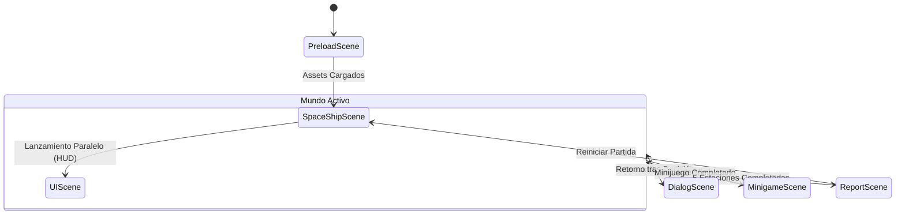

# Arquitectura Técnica del Sistema: AstroPath 🛸⚙️

Este documento describe la arquitectura de software, patrones de diseño, ciclo de vida de escenas, flujo de datos y convenciones técnicas para el motor y la base de código de **AstroPath**.

---

## 1. Stack Tecnológico

| Componente | Tecnología | Versión | Justificación Técnica |
| :--- | :--- | :--- | :--- |
| **Motor de Juego** | [Phaser 4](https://phaser.io/) | `^4.2.1` | Renderizado WebGL/Canvas de alto rendimiento, soporte nativo de Tilemaps, física Arcade 2D y pipeline de efectos. |
| **Lenguaje** | [TypeScript](https://www.typescriptlang.org/) | `^7.0.2` | Tipado estricto, interfaces compartidas y prevención de errores en tiempo de compilación. |
| **Bundler & Dev** | [Vite](https://vitejs.dev/) | `^8.3.4` | HMR instantáneo en desarrollo y empaquetado optimizado mediante Rolldown para producción. |
| **Testing E2E** | [Playwright](https://playwright.dev/) | `^1.64.0` | Automatización de pruebas end-to-end sobre canvas, eventos de teclado y ciclos de escenas. |
| **Mapas 2D** | Tiled Map Editor | TMX / JSON | Creación de capas de terreno, decoración y zonas de colisión espacial. |

---

## 2. Diagrama de Arquitectura de Capas

```
┌────────────────────────────────────────────────────────────────────────┐
│                        CAPA DE PRESENTACIÓN (UI/HUD)                  │
│   UIScene (Radar holográfico, Bitácora PDA, Modal Onboarding, Toasts)  │
└───────────────────────────────────┬────────────────────────────────────┘
                                    │ Eventos Globales
                                    ▼
┌────────────────────────────────────────────────────────────────────────┐
│                       CAPA DEL MUNDO Y JUGABILIDAD                    │
│   SpaceShipScene (Tilemaps, Física Arcade, Colisiones, Control Jugador)│
│                                   │                                    │
│       ┌───────────────────────────┴────────────────────────────┐      │
│       ▼                                                        ▼      │
│   DialogScene (Modal)                                 Minijuegos (5)  │
│   - Testimonios Pasajeros                             - RoboticsScene │
│   - Opciones Ponderadas                               - NetworkScene  │
│   - Feedback Likert                                   - SecurityScene │
│                                                       - DataScene     │
│                                                       - BizScene      │
└───────────────────────────────────┬────────────────────────────────────┘
                                    │ Actualizaciones de estado
                                    ▼
┌────────────────────────────────────────────────────────────────────────┐
│                      CAPA DE ESTADO Y DOMINIO (STATE)                  │
│   GameState (Singleton)                                                │
│   - Vector de Afinidad (dev, net, sec, data, biz)                      │
│   - Control de Misiones y Progreso de Estaciones                       │
│   - Algoritmo Multicriterio de Normalización                           │
└───────────────────────────────────┬────────────────────────────────────┘
                                    │
                                    ▼
┌────────────────────────────────────────────────────────────────────────┐
│                         CAPA DE DATOS ESTÁTICOS                        │
│   stations.ts (Dilemas y Pesos)  •  careerProfiles.ts (Carreras TI)    │
│   types/vocational.ts (Interfaces de Dominio)                          │
└────────────────────────────────────────────────────────────────────────┘
```

---

## 3. Arquitectura y Ciclo de Vida de Escenas

AstroPath utiliza una arquitectura de **escenas desacopladas y paralelas** para garantizar una experiencia fluida sin recargas de pantalla:



### 3.1 Catálogo de Escenas

1. **`PreloadScene`**:
   - Carga y decodifica texturas, spritesheets, audio (efectos de interfaz, bleeps, ambiente de nave) y fuentes tipográficas.
   - Genera dinámicamente texturas procedimentales si algún asset temporal no se encuentra en disco.

2. **`SpaceShipScene`**:
   - Escena principal del mundo 2D. Instancia el mapa de tiles de la nave (`spaceship.tmx` / JSON).
   - Configura la física Arcade: gravedad en cero, colisiones en capas de paredes y terminales, y cuerpos de colisión con NPCs.
   - Maneja el movimiento del cadete mediante `WASD` / Flechas y el joystick táctil.
   - Al abrir un diálogo o minijuego, suspende su input (`this.scene.pause('SpaceShipScene')`) para prevenir movimientos no intencionados.

3. **`UIScene`**:
   - Corre permanentemente como overlay encima de `SpaceShipScene`.
   - **Radar Holográfico:** Muestra la posición del jugador respecto a las 5 estaciones con pines de colores reactivos (pendiente, en curso, completada).
   - **Bitácora de a Bordo (PDA):** Ventana modal desplegable con `TAB` o botón táctil con el resumen de tareas activas.
   - **Modal de Onboarding:** Presenta la bienvenida al cadete al iniciar la partida.

4. **`DialogScene`**:
   - Manejador modal de conversación. Renderiza cajas de texto translúcidas estilo consola espacial con efecto typewriter (máquina de escribir).
   - Soporta branching para entrevistas a testigos, presentación de dilemas, selector de alternativas ponderadas y escala Likert táctil (1 a 5).

5. **Minijuegos Temáticos (`src/scenes/minigames/`)**:
   - Escenas independientes y autocontenidas:
     - `RoboticsMinigameScene`: Programación visual en bloques para rutas de robots.
     - `NetworkMinigameScene`: Conmutación de nodos de señal y enrutamiento sin cuellos de botella.
     - `SecurityMinigameScene`: Cobertura de sensores en piso y mitigación de intrusiones.
     - `DataMinigameScene`: Gráfico de dispersión y alineación de variables climáticas.
     - `BizMinigameScene`: Gestión de energía recreativa y balance de satisfacción comunitaria.
   - Al terminar, emiten el resultado al `GameState`, se destruyen con `this.scene.stop()` y reactivan la escena del mundo.

6. **`ReportScene`**:
   - Se invoca al interactuar con la consola central habiendo completado las 5 estaciones.
   - Dibuja mediante `Phaser.GameObjects.Graphics` el gráfico de radar pentagonal normalizado.
   - Renderiza tarjetas con el perfil primario y secundario del estudiante, mapeando carreras universitarias afines (`careerProfiles.ts`).

---

## 4. Gestión de Estado Global (`src/state/GameState.ts`)

El estado del juego sigue el patrón **Singleton**, accesible globalmente a través de `GameState.getInstance()`:

### 4.1 Estructura del Estado
```typescript
interface GameStateData {
  affinity: {
    dev: number;
    net: number;
    sec: number;
    data: number;
    biz: number;
  };
  stations: Record<string, StationProgress>;
  visitedWitnesses: Set<string>;
  currentStationId: string | null;
  onboardingSeen: boolean;
}
```

### 4.2 Métodos Principales
* `recordResolution(stationId, chosenOptionIndex, likertScore, timeSpentSeconds)`: Calcula la ponderación combinada $P_1, P_2, P_3$ e incrementa el vector de afinidad acumulado.
* `getNormalizedAffinity()`: Retorna los porcentajes normalizados ($\sum = 100\%$) para graficar en el pentagrama.
* `getTopCareers()`: Determina las ramas líder y consulta las carreras afines en `careerProfiles.ts`.
* `reset()`: Limpia el progreso para iniciar una nueva sesión sin necesidad de recargar la página.

---

## 5. Sistema de Controles Híbrido (Desktop & Mobile)

AstroPath está optimizado tanto para computadoras de escritorio como para pantallas táctiles y dispositivos móviles:

1. **Entrada de Teclado:**
   - Movimiento: `W`, `A`, `S`, `D` o teclas de flechas direccionales.
   - Interacción: Tecla `E` o barra espaciadora (`Space`).
   - Bitácora / PDA: Tecla `TAB` o `B`.
2. **Entrada Táctil / Móvil:**
   - Joystick virtual táctil ubicado dinámicamente en el cuadrante inferior izquierdo.
   - Botón de acción rápido ("Interrogar / Acción") en el cuadrante inferior derecho.
   - Botones de interfaz con áreas de toque (*hit area*) ampliadas para evitar pulsaciones erróneas.
3. **Escalado y Viewport:**
   - Resolución base: `1024 x 640` con `Phaser.Scale.FIT` y `autoCenter: Phaser.Scale.CENTER_BOTH`.
   - Propiedad `pixelArt: true` en `GameConfig` para mantener bordes nítidos sin interpolación borrosa.

---

## 6. Convenciones de Código y Buenas Prácticas

1. **Destrucción y Limpieza de Recursos:**
   - Todo listener registrado con `this.events.on(...)` o `scene.events.on(...)` debe ser removido en el evento `shutdown` de la escena.
   - Cancelar tweens activos con `this.tweens.killAll()` antes de salir de minijuegos para prevenir referencias huérfanas.
2. **Separación de Datos y Vistas:**
   - Toda la información de textos, opciones, pesos y perfiles reside en `src/data/` y nunca debe ser hardcodeada dentro de las clases de escena.
3. **Manejo Estricto de Tipos:**
   - Utilizar las interfaces definidas en `src/types/vocational.ts` para todos los payloads de eventos y llamadas a métodos de negocio.

---

## 7. Pruebas Automatizadas y Calidad

El proyecto cuenta con suites de pruebas E2E configuradas con **Playwright** (`playwright.config.ts`):
* Verificación de arranque de Phaser y renderizado del canvas.
* Ciclo de apertura, interacción y cierre de `DialogScene`.
* Transición hacia minijuegos y retorno a `SpaceShipScene`.
* Renderizado del reporte vocacional al completar las 5 estaciones.

Comando de ejecución de pruebas:
```bash
npx playwright test
```
