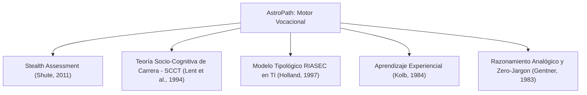

# Constitución del Proyecto: AstroPath 📜🌌
### Modelo Funcional de Negocio y Fundamentación Psicopedagógica de la Odisea Vocacional Estelar

---

## 1. Declaración de Misión y Visión

### 1.1 Misión
Democratizar, desmitificar y orientar la vocación profesional hacia las **Tecnologías de la Información (TI)** en estudiantes de educación secundaria, preuniversitarios y personas en proceso de reinvención profesional, mediante una experiencia lúdica inmersiva (*Serious Game*) que elimina las barreras de lenguaje técnico y mide aptitudes genuinas a través de la resolución de situaciones contextualizadas.

### 1.2 Visión de Negocio
Convertirse en el estándar interactivo de exploración vocacional para instituciones educativas, plataformas de orientación vocacional y universidades, transformando los tradicionales cuestionarios estáticos en una experiencia inmersiva vivencial (*Stealth Assessment*) con alta fidelidad diagnóstica y engagement emocional.

---

## 2. Marco Teórico e Investigaciones que Respaldan el Proyecto

El diseño de las mecánicas de juego, las dinámicas de evaluación y las métricas multicriterio de **AstroPath** está fundamentado en cinco marcos científicos e investigaciones consolidadas:



### 2.1 Evaluación Silenciosa (*Stealth Assessment* - Valerie Shute, 2011)
Los tests vocacionales psicométricos tradicionales (inventarios de papel o formularios web de 60 a 100 preguntas descontextualizadas) inducen sesgos de deseabilidad social, fatiga cognitiva y ansiedad de evaluación.
* **Aplicación en AstroPath:** El diagnóstico se embebe de manera invisible dentro del bucle de juego (*core gameplay loop*). El usuario no siente que está rindiendo un examen; actúa como un tripulante novato resolviendo problemas reales dentro de una nave. Cada interacción (tiempo de lectura, exploración del entorno, orden de resolución, toma de decisiones) alimenta el perfil del estudiante en tiempo real.

### 2.2 Teoría Socio-Cognitiva del Desarrollo de Carrera (*SCCT* - Lent, Brown & Hackett, 1994, 2002)
La teoría SCCT postula que los intereses y la elección final de carrera no solo dependen de la habilidad técnica o de la aptitud abstracta, sino crucialmente de dos factores cognitivo-afectivos:
1. **Autoeficacia percibida:** *"¿Me siento capaz de abordar este tipo de problema?"*
2. **Expectativa de resultados y disfrute:** *"¿Me resulta gratificante o estimulante esta labor?"*
* **Aplicación en AstroPath:** Tras cada estación, el jugador responde una escala Likert afectiva (1 a 5) evaluando su autopercepción y disfrute. Esta variable actúa como un modulador multiplicativo ($P_3$), reconociendo que el éxito vocacional a largo plazo está fuertemente correlacionado con la satisfacción intrínseca del individuo.

### 2.3 Tipología Vocacional Hexagonal adaptada al Ecosistema Digital (John Holland, 1997)
El modelo RIASEC postula que las personas y los ambientes laborales se agrupan en orientaciones de personalidad. AstroPath mapea estas dimensiones al ecosistema moderno de TI:
* **Investigativo / Convencional (I-C):** *Desarrollo de Software (`dev`)* — Lógica abstracta, síntaxis estructurada, descomposición analítica de problemas.
* **Realista / Investigativo (R-I):** *Redes e Infraestructura (`net`)* — Conectividad física y lógica, rutas estables, flujos de transmisión y tolerancia a fallos.
* **Convencional / Investigativo (C-I):** *Ciberseguridad (`sec`)* — Detección de patrones anómalos, blindaje de perímetros, auditoría de permisos y preservación de privacidad.
* **Investigativo / Analítico (I-A):** *Ciencia de Datos e Inteligencia Artificial (`data`)* — Observación empírica, reconocimiento de tendencias estadísticas y ajuste paramétrico.
* **Emprendedor / Social (E-S):** *Gestión y Análisis de Negocios (`biz`)* — Mediación de necesidades humanas, priorización de recursos limitados, empuje estratégico y comunicación interpersonal.

### 2.4 Ciclo de Aprendizaje Experiencial (David Kolb, 1984)
Para que una persona descubra si un área le interesa genuinamente, debe transitar las 4 etapas del ciclo de Kolb. Cada estación de AstroPath replica este proceso:
1. **Experiencia Concreta (Inmersión):** El NPC Líder expone el conflicto cotidiano de la estación.
2. **Observación Reflexiva (Empatía):** El jugador dialoga con pasajeros/tripulantes para recolectar testimonios y comprender causas subyacentes.
3. **Conceptualización Abstracta (Experimentación Práctica):** El jugador ejecuta el minijuego de la estación, manipulando la lógica básica del dominio sin tecnicismos.
4. **Experimentación Activa (Decisión Ponderada):** El jugador elige una propuesta de solución para la nave y evalúa su experiencia interna.

### 2.5 Razonamiento Analógico y Enfoque Libre de Jerga (*Zero-Jargon* - Gentner, 1983; Holyoak & Thagard, 1995)
El uso prematuro de tecnicismos (ej. *back-end, subredes, endpoints, hashes, overfitting, sprints*) actúa como un filtro socioeconómico y cultural excluyente para jóvenes que aún no han tenido contacto con la industria.
* **Principio Rector:** Toda competencia técnica se expresa a través de **metáforas espaciales de a bordo**:
  * *Software* $\rightarrow$ "Automatización de secuencias para robots repartidores".
  * *Redes* $\rightarrow$ "Antenas de comunicación y caminos sin interferencia entre cabinas".
  * *Ciberseguridad* $\rightarrow$ "Vigilancia de credenciales y cuadrícula de sensores en almacenes".
  * *Datos e IA* $\rightarrow$ "Calibración de variables climáticas en el invernadero hidropónico según registros de sensores".
  * *Gestión* $\rightarrow$ "Reparto justo de energía y mediación de actividades en el lounge comunitario".

---

## 3. Dimensiones Evaluadas y Perfiles Vocacionales

AstroPath mide la inclinación del usuario a través de un vector de afinidad de 5 dimensiones:

$$\vec{A} = (S_{\text{dev}}, S_{\text{net}}, S_{\text{sec}}, S_{\text{data}}, S_{\text{biz}})$$

### 3.1 Las 5 Estaciones de la Nave

| Estación | Rama Evaluada | Líder de Área | Núcleo del Conflicto | Rasgos Vocacionales Observados |
| :--- | :--- | :--- | :--- | :--- |
| **1. Bahía de Ensamblaje** | `dev` (Desarrollo) | **Mika**, la Inventora | Robots de cocina dan vueltas en círculos y confunden bandejas por instrucciones ambiguas. | Pensamiento algorítmico, lógica secuencial, capacidad de abstracción y depuración. |
| **2. Sala de Comunicaciones** | `net` (Redes) | **Orion**, el Comunicador | Las videollamadas entre sectores se cortan por congestión de antenas y enlaces rotos. | Visión topológica, optimización de caminos críticos, interés por infraestructura y conectividad. |
| **3. Puesto de Vigilancia** | `sec` (Ciberseguridad) | **Kael**, el Guardián | Ingresos no autorizados al almacén mediante credenciales prestadas y puertas sin sensor. | Mentalidad preventiva, vigilancia de vulnerabilidades, integridad de acceso y ética de resguardo. |
| **4. Laboratorio Bio-Sensores** | `data` (Datos e IA) | **Nova**, la Investigadora | Los cultivos del invernadero maduran a destiempo debido a variables climáticas fluctuantes. | Pensamiento inductivo, análisis de tendencias históricas, correlación de variables numéricas. |
| **5. Lounge Social** | `biz` (Gestión/Negocio) | **Dra. Valeria**, la Coordinadora | Pasajeros con intereses encontrados compiten por el racionamiento de energía recreativa. | Inteligencia interpersonal, escucha activa, negociación estratégica y optimización de recursos. |

---

## 4. Dinámica Funcional del Usuario (User Journey)

El flujo del estudiante a lo largo de la experiencia se estructura en tres fases:

```
┌────────────────────────────────────────────────────────────────────────┐
│                          1. EMBARQUE Y TUTORIAL                        │
│      Recepción en el Puente Central • HUD holográfico • Bitácora       │
└───────────────────────────────────┬────────────────────────────────────┘
                                    │
                                    ▼
┌────────────────────────────────────────────────────────────────────────┐
│                      2. EXPLORACIÓN DE LAS 5 ESTACIONES                │
│    (Orden no lineal: el usuario decide a qué sector dirigirse primero) │
│                                                                        │
│   ┌────────────────────────────────────────────────────────────────┐   │
│   │ Cada estación incluye:                                         │   │
│   │   a) Diálogo introductorio con el Líder de Área                │   │
│   │   b) Entrevistas a 2 tripulantes / pasajeros testigos          │   │
│   │   c) Minijuego interactivo temático                            │   │
│   │   d) Propuesta de solución (elección múltiple ponderada)       │   │
│   │   e) Pregunta de satisfacción emocional (Likert 1–5)           │   │
│   └────────────────────────────────────────────────────────────────┘   │
└───────────────────────────────────┬────────────────────────────────────┘
                                    │
                                    ▼
┌────────────────────────────────────────────────────────────────────────┐
│                   3. INFORME FINAL DE ORIENTACIÓN VOCACIONAL           │
│   Retorno al Puente Central • Radar Pentagonal de Afinidad (%)         │
│   Ficha de Rama Dominante + Secundaria • Carreras Universitarias       │
└────────────────────────────────────────────────────────────────────────┘
```

---

## 5. Modelo Matemático y Algoritmo de Evaluación

El sistema utiliza un **modelo de ponderación multicriterio aditivo-multiplicativo**:

### 5.1 Componentes de Puntuación
1. **Ponderación de Propuesta ($P_1$):** Cada alternativa de solución otorga puntos distribuidos entre las 5 ramas de acuerdo a la naturaleza de la intervención (ej. una solución automatizada suma fuertemente a `dev` y secundariamente a `net`).
2. **Estilo de Exploración y Lectura ($P_2$):** El tiempo dedicado a dialogar con los testigos y analizar el problema modula bonificaciones sutiles de paciencia analítica (`data` / `biz`) versus resolución ágil (`dev` / `net`). **Principio clave:** El tiempo invertido jamás penaliza ni produce derrota; solo calibra el perfil de trabajo.
3. **Multiplicador de Satisfacción Afectiva ($P_3$):** La respuesta en escala Likert (1 a 5) traduce la autopercepción de disfrute en un factor multiplicador entre $1.0$ y $1.5$:

$$\text{Puntaje\_Estación}(k) = \left( P_1(k) + P_2(k) \right) \times \left(1.0 + \frac{\text{Likert}_k - 1}{8}\right)$$

### 5.2 Normalización y Salida Vocacional
Al concluir las 5 estaciones, los puntajes acumulados se normalizan porcentualmente:

$$\% \text{ Afinidad}_i = \frac{S_i}{\sum_{j=1}^{5} S_j} \times 100$$

El resultado se presenta al usuario como:
* **Pentagrama / Gráfico de Radar:** Visualización intuitiva del equilibrio de intereses.
* **Arquetipo Principal:** Identificación del área con mayor afinidad relativa (ej. *Arquitecto de Sistemas*, *Guardián Digital*, *Estratega de Producto*).
* **Afinidad Secundaria:** Reconocimiento de combinaciones interdisciplinarias (ej. Software + Datos = IA/Machine Learning; Redes + Seguridad = DevSecOps/Cloud Security).
* **Catálogo de Opciones Académicas:** Recomendación concreta de carreras universitarias, tecnicaturas y certificaciones reales.

---

## 6. Principios de Ética y No Exclusión

1. **No Rotulación Negativa:** No existen perfiles "reprobados" ni resultados "malos". Todas las configuraciones vocacionales representan talentos valiosos y necesarios en la industria de TI.
2. **Neutralidad de Género y Contexto:** Personajes, avatares y situaciones están diseñados para reflejar diversidad e inclusión, sin sesgos preconcebidos sobre quién "debe" dedicarse a una determinada rama tecnológica.
3. **Transparencia Vocacional:** Al finalizar la partida, el usuario puede revisar qué aspectos de sus decisiones influyeron en sus resultados, fomentando el autoconocimiento reflexivo.
